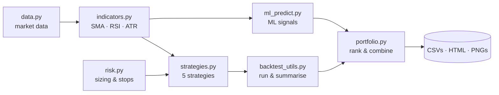

<div align="center">


<br/>


**A quantitative backtesting backend that doesn't trust a single signal.**
Five strategies · four NSE stocks · risk-aware sizing · an ML layer on top.

[Overview](#-overview) · [Architecture](#-architecture) · [Strategies](#-the-strategy-stack) · [Risk](#-risk-engine) · [Outputs](#-outputs) · [Quick Start](#-quick-start)

</div>

<br/>

## ✦ Overview

A *simple* backend runs one rule on one asset and reports one number.

A *multidimensional* backend looks at the same market from several angles at once, then reconciles them:

| | Simple backend | **Multidimensional backend** |
|---|---|---|
| Signals | 1 | **5 strategies + ML predictions** |
| Assets | 1 | **4 stocks, compared side by side** |
| Position sizing | fixed | **ATR / fixed-fraction, risk-per-trade** |
| Exits | manual / none | **ATR or % stop-loss and take-profit** |
| Decision | one rule | **majority vote (ensemble)** |
| Output | a number | **HTML reports, CSV summaries, plots** |

Built during the **Round 3 Algo Competition**, and kept as a clean reference for how a layered trading backend fits together.

<br/>

## ✦ Architecture



<br/>

## ✦ The Strategy Stack

Every strategy inherits from one `BaseRiskStrategy`, so each gets identical sizing and stop logic. Only the *signal* differs.

| Strategy | Idea | Enter | Exit |
|---|---|---|---|
| 📈 **Moving Average** | Trend following | SMA(20) crosses above SMA(50) | SMA(50) crosses back above SMA(20) |
| 🚀 **Momentum** | Ride strength | 20-day return > 0 | 20-day return ≤ 0 |
| 🔁 **Mean Reversion** | Fade extremes | z-score < −1.5 | z-score > +1.5 |
| 🌡️ **RSI** | Oversold bounce | RSI(14) < 30 | RSI(14) > 70 |
| 🗳️ **Ensemble** | Let signals vote | net vote > 0 | net vote < 0 |

The **Ensemble** scores four independent votes (MA10/MA20 trend, 20-day momentum, RSI, 20-day z-score) and only acts when they agree on a direction.

<br/>

## ✦ Risk Engine

Signals decide *when*. `risk.py` decides *how much* and *when to bail*.

- **ATR position sizing** sizes each trade so a stop-out costs roughly a fixed slice of equity (`risk_per_trade`)
- **Fixed-fraction fallback** kicks in when ATR isn't available yet
- **Dynamic exits** put the stop at `ATR × multiplier` and the target at twice that distance
- **Percentage exits** (`stop_loss_pct` / `take_profit_pct`) are used when ATR is unavailable
- **Kelly fraction** helper is available and togglable through config

All knobs live in `config.py`.

<br/>

## ✦ Universe

```
HDFCBANK   ·   INFY   ·   RELIANCE   ·   TCS
```

Each stock is run through every strategy, giving a 4 × 5 grid of results.

<br/>

## ✦ Outputs

| Artifact | What it is |
|---|---|
| `{TICKER}_{strategy}.html` | Interactive backtest report per stock and strategy (`ma`, `meanrev`, `momentum`, `rsi`, `ensemble`) |
| `backtest_summary.csv` / `summary.csv` | Metrics for every run |
| `best_strategies.csv` | Winning strategy per stock |
| `ml_predictions.csv` | Model predictions |
| `feature_importance*.png` | What the ML model leaned on, overall and per stock |
| `portfolio_top20.png` | Top-ranked picks across the universe |

<br/>

## ✦ Project Structure

```
Multidimensional-backend/
├── config.py            # risk + run parameters
├── data.py              # market data loading
├── indicators.py        # sma, rsi, atr
├── strategies.py        # BaseRiskStrategy + 5 strategies
├── risk.py              # sizing, stops, kelly
├── ensemble.py          # ensemble logic
├── ml_predict.py        # ML signal layer
├── portfolio.py         # ranking & portfolio view
├── backtest_utils.py    # run + summarise backtests
├── Round3_Algo_Competition.ipynb
└── *.csv · *.html · *.png   # generated results
```

<br/>

## ✦ Quick Start

```bash
git clone https://github.com/shiv0xparanoid/Multidimensional-backend.git
cd Multidimensional-backend
pip install backtesting pandas numpy matplotlib jupyter
```

Then open **`Round3_Algo_Competition.ipynb`** to run the full pipeline, or open any generated `*.html` report straight in your browser.

> **Heads up:** modules import each other as `app.*` (e.g. `from app.indicators import sma`). Keep the files inside an `app/` package when running them as scripts.

<br/>

## ✦ Roadmap

- [ ] Fill in `main.py` as a single CLI entry point
- [ ] Walk-forward validation for the ML layer
- [ ] Transaction cost and slippage modelling
- [ ] Short-side strategies
- [ ] Live paper-trading hook

<br/>

## ✦ License

MIT, see [`LICENSE`](LICENSE).

<div align="center">

<br/>

Built by **[Shivang](https://github.com/shiv0xparanoid)**

<sub>For research and education only. Not financial advice.</sub>


</div>
